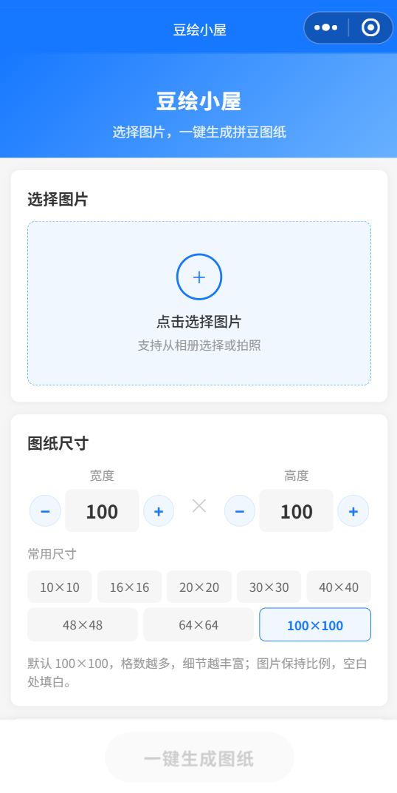
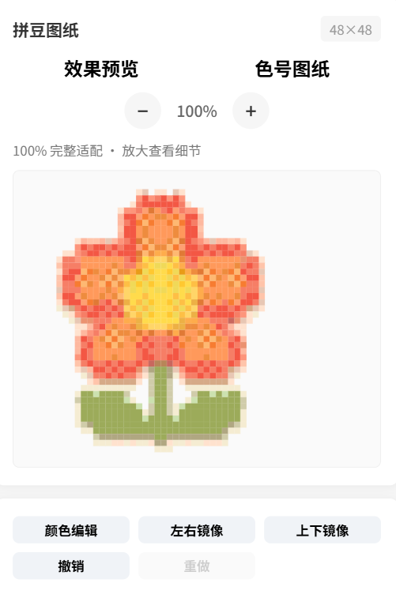
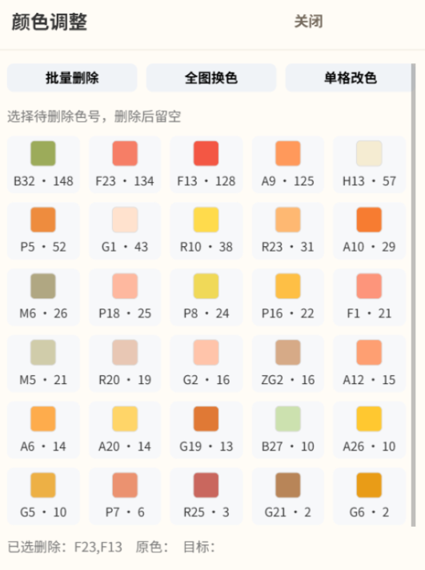
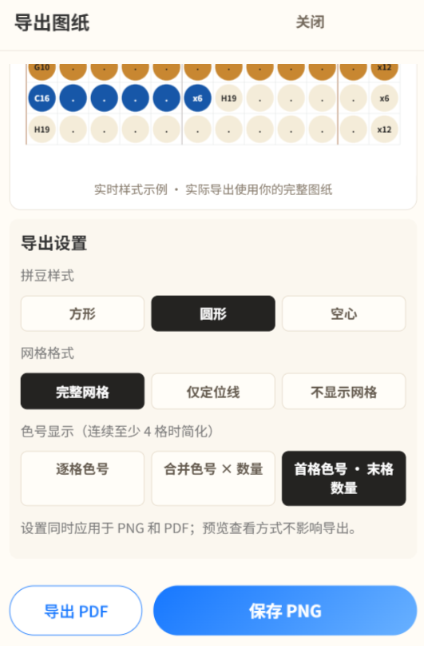
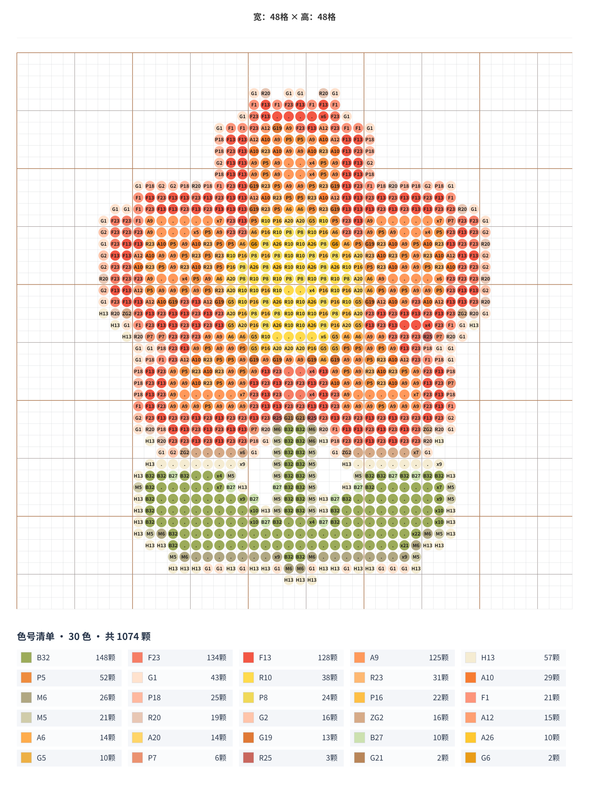
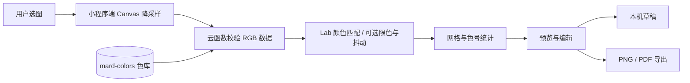

# 豆绘小屋 · Mard 拼豆图纸生成器

把照片转成可编辑、可统计用量、可导出的拼豆图纸。基于**微信原生小程序 + 微信云开发**，覆盖选图、生成、编辑、保存和导出流程。

> 项目源码展示。运行云端生成需要配置自己的小程序 AppID、云环境和真实色卡数据库；仓库不包含生产色库、密钥或个人图片，也不代表已通过微信平台审核。

## 项目实拍与导出成果

以下为项目界面与导出图纸截图，展示选图配置、结果预览、颜色编辑和导出流程。首页展示默认 100×100 配置；花朵示例使用 48×48 图纸，两者为不同操作阶段的截图。

<table>
  <tr>
    <th>选图与尺寸配置</th>
    <th>图纸效果预览</th>
  </tr>
  <tr>
    <td></td>
    <td></td>
  </tr>
  <tr>
    <th>颜色编辑</th>
    <th>导出设置</th>
  </tr>
  <tr>
    <td></td>
    <td></td>
  </tr>
</table>

### 导出的色号图纸

花朵示例为 **48×48 格、30 色、共 1074 颗**。图纸展示圆形拼豆、完整网格、连续色号简化标注，以及各色号的用量清单；48×48 是网格尺寸，1074 是实际用豆数量。

[查看完整分辨率图纸](docs/screenshots/exported-pattern.png)



截图由项目作者提供，按原图收录；仅用于展示已呈现的界面与导出效果，不替代真机、云端部署或微信审核验证。展示图片存放在文档目录，不进入小程序代码包。

## 功能一览

| 环节 | 已实现能力 |
| --- | --- |
| 图片处理 | 选取图片、等比缩放、透明背景合成白色、区域平均采样 |
| 图纸生成 | 5–100 格宽高、默认 100×100、照片模式、可选抖动、可选 8–64 色上限 |
| 图纸查看 | 效果预览与色号图纸切换、缩放查看、色号与颗数统计 |
| 图纸编辑 | 单格改色、全图换色、批量删除、水平/垂直镜像、撤销与重做 |
| 图纸导出 | PNG 与矢量 PDF；方形、圆形、空心样式；网格和色号标注选项 |
| 使用体验 | 本机恢复最近图纸、色库加载失败后重试、首页分享、原生意见反馈 |

## 技术亮点

- **颜色匹配**：使用 D65 CIELAB / Delta E 76 在真实色卡中寻找近似颜色；限色时通过加权主色聚类选择候选色号，兼顾细节与采购复杂度。
- **前后端分工**：客户端完成图片降采样和编辑导出，云函数完成色库读取与颜色匹配，算法独立为纯函数，便于测试。
- **输入和数据校验**：云函数校验尺寸、Base64 编码与像素长度；生成算法拒绝重复色号或不一致的 RGB/HEX；草稿恢复根据网格重建颗数。
- **异步渲染处理**：限制 Canvas 重试并在页面卸载时取消；预览仅接收最新请求的结果，避免快速切换时旧图覆盖新图。
- **导出与包体控制**：PNG 限制最长边与总像素；PDF 使用矢量输出；上传开启压缩、组件按需注入和无依赖文件过滤。

## 架构



实现细节和取舍见 [架构说明](docs/ARCHITECTURE.md)。

## 快速运行

### 1. 准备环境

- 微信开发者工具、小程序 AppID，以及对应的微信云开发环境。
- Node.js 22，用于运行本地测试。测试使用内置框架，不需要安装小程序 UI 依赖。

```bash
git clone https://github.com/Wyl-510-www/mard-bead-generator.git
cd mard-bead-generator
node --test tests/*.test.js
```

### 2. 配置小程序和云函数

1. 使用微信开发者工具导入仓库根目录。
2. 将 `project.config.json` 中的 `YOUR_WECHAT_APPID` 替换为自己的 AppID。
3. 将 `miniprogram/app.js` 中的 `YOUR_CLOUD_ENV_ID` 替换为自己的云环境 ID。
4. 在开发者工具中上传并部署 `cloudfunctions/generateBeadPattern`，选择“云端安装依赖”，确保同时上传 `pattern.js`。
5. 在同一云环境中建立 `mard-colors` 集合，导入有权使用的真实色卡，然后重新编译。

色卡每条记录需包含以下字段：

| 字段 | 类型 | 要求 |
| --- | --- | --- |
| `code` | string | 唯一、非空的色号 |
| `name` | string | 颜色名称，用于展示 |
| `hex` | string | `#RRGGBB` 格式 |
| `r`、`g`、`b` | integer | 0–255，必须与 HEX 一致 |

不要为客户端开放数据库写权限。色卡由云函数读取；数据库权限、云函数权限与额度应在自己的云环境中配置。仓库测试中的少量受控颜色仅用于验证逻辑，不是正式 Mard 色卡。

### 3. 体验完整流程

选择图片 → 设置宽高和用色上限 → 生成图纸 → 切换色号预览 → 编辑颜色 → 导出 PNG/PDF。重新打开小程序可继续最近一次保存在本机的图纸。

## 测试与质量

```bash
node --test tests/*.test.js
```

| 测试范围 | 主要检查 |
| --- | --- |
| 颜色算法 | Lab 参考值、精确颜色、限色上限、抖动确定性、透明像素处理 |
| 云函数入口 | 无效输入在访问数据库前拒绝、合法生成与色库读取 |
| 网格编辑 | 镜像、删除留空、换色、颗数统计 |
| 页面交互 | 生成参数快照、预览回调次序、重试与卸载、草稿恢复 |
| 导出与包体 | PDF 对象偏移、色号标注、PNG 内存预算、上传排除与资源大小 |

GitHub Actions 在 push 和 pull request 时执行同一套测试。测试通过不等于真实云环境已部署或微信审核通过。

## 目录结构

```text
.
├── miniprogram/
│   ├── pages/index/             # 图片输入与生成参数
│   ├── pages/result/            # 预览、编辑、统计和导出
│   ├── utils/                  # 图像采样、编辑、草稿与 PDF
│   └── images/beadlog.jpg       # 分享配图
├── cloudfunctions/
│   └── generateBeadPattern/
│       ├── index.js            # 参数校验和云数据库读取
│       └── pattern.js          # 颜色匹配与图纸生成算法
├── tests/                      # Node.js 自动化测试
├── docs/ARCHITECTURE.md         # 数据流、取舍及测试边界
├── .github/workflows/test.yml   # 持续集成
└── project.config.json         # 微信开发者工具配置
```

## 当前限制与后续方向

- 当前没有随仓库提供可直接体验的小程序码或完整生产色库；需自行配置环境。
- 照片转像素图存在细节与杂色的取舍，屏幕预览不能保证实物完全一致；后续可补充统一样图下的效果比较。
- 本机仅保留最近一份图纸，不含原图和撤销历史；清除小程序数据会移除草稿。
- PDF 内置字体仅支持 ASCII 标签，中文名称无法完整呈现。
- 真机流畅度、相册授权、云函数线上行为及性能扫描需要在微信环境单独验收。

## 项目说明

本项目用于学习、作品展示与技术交流。Mard 名称用于说明目标色卡体系，不表示官方合作或授权；色卡和用户上传图片的使用权需由使用者自行确认。本仓库暂未指定开源许可证，公开可见不等于已授予任意复用授权。
